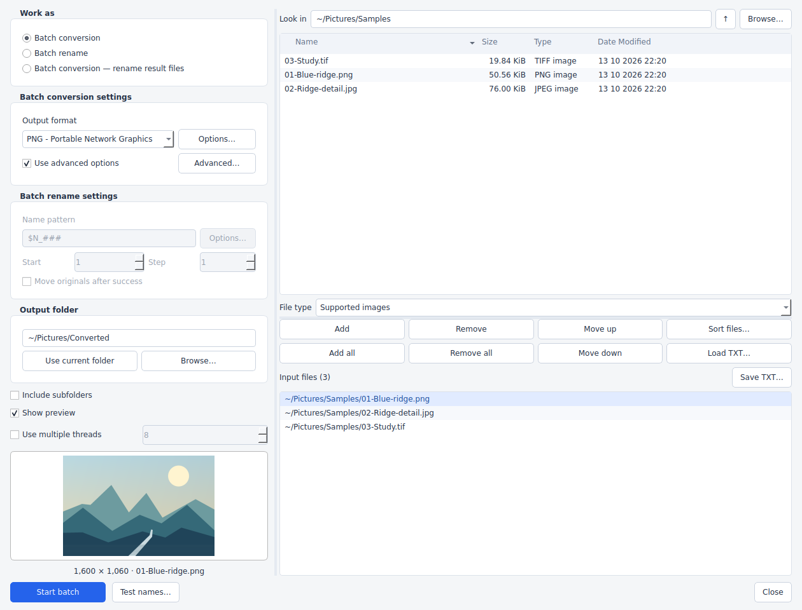

# LumaView

An image viewer and batch converter for **Apple Silicon Macs**, inspired by IrfanView's workflow.

**macOS 14+ · English interface · MIT licensed**

[Download](https://github.com/PianothShaveck/LumaView/releases/latest) · [Illustrated guide](docs/LumaView-Guide.pdf) · [Features and limitations](docs/FEATURES.md)



## Features

- Press **B** to convert, rename, or convert and rename a batch of images.
- Resize with Lanczos, bicubic and other resampling filters; crop, rotate, adjust colors, add text, borders and watermarks.
- Keep format-specific options visible beside **Save As**, with reusable export profiles.
- Create compact monochrome TIFFs with **Adaptive (IrfanView style)** dithering and CCITT Fax compression.
- Work with multipage TIFF/PDF, animated images, thumbnails, slideshows and local macOS OCR.
- Export JPEG, PNG, TIFF, PDF, GIF, WebP, HEIC, AVIF, JPEG XL and [other formats](docs/FEATURES.md). Read camera RAW, SVG and flattened PSD images as well.

Independent project; not affiliated with IrfanView. Windows plug-ins and IrfanView settings files are not supported.

## Install

**Recommended:** download `LumaView-<version>-macos-arm64.dmg` from [Releases](https://github.com/PianothShaveck/LumaView/releases/latest), open it, and drag **LumaView** to **Applications**. The app includes Python and its required libraries. No separate installation or internet connection is needed to run it.

The `macos-arm64.zip` contains the same application. These builds require an Apple Silicon Mac; Intel Macs are not supported.

### First launch

Builds are ad-hoc signed, without Apple Developer ID signing or notarization. If macOS blocks opening an unverified app, attempt to open it, then go to **System Settings → Privacy & Security → Open Anyway**. See [Apple's instructions](https://support.apple.com/102445). A warning that the app is damaged or harmful is different: download a fresh copy and verify the release checksum.

### Source installer

Extract `LumaView-<version>-installer.zip` and double-click **Install.command**. The installer downloads native Python and the required libraries into a private environment, then opens `~/Applications/LumaView.app`. It needs internet access, but no Homebrew, developer tools, administrator password or existing Python installation.

Run the installer again to update or repair this installation. The extracted folder can then be deleted; keep `~/Library/Application Support/LumaView`, which contains the installed runtime. The repository ZIP also includes `Install.command`.

## Quick start

1. Open an image, or press **B** for a batch.
2. Add input files, choose an output folder and select the output format.
3. Use **Options** for encoder settings and **Advanced** for transformations, then **Start batch**.

For high-quality resizing, enable **Use Resample function (better quality)**. At 100%, resampling preserves image dimensions; it does not independently compress files.

For monochrome TIFF, select **CCITT Fax 4** and **Adaptive (IrfanView style)**. Leave **Blend alpha with background** unchecked to use stored RGB values, or enable it to flatten transparency. [How the monochrome converter works](docs/MONOCHROME.md).

**Settings** controls PDF input DPI and SVG raster size. Defaults are 96 DPI and 1024 × 800 pixels; PDF export DPI is separate.

## Limitations

- Editing is primarily 8-bit per channel. This is not a layered, HDR or archival high-bit-depth editor.
- PDF and SVG input is rasterized. PDF export contains page images, not the original searchable text, links or vectors. Different renderers can produce different edges or geometry.
- PSD reads the merged image. PhotoLine PLD/PLB reads an embedded preview or thumbnail, not full-resolution layers.
- Available codecs and supported file variants depend on the bundled libraries. **Help → Supported formats** lists the installed capabilities.
- EPS input needs an optional Ghostscript installation; **OptiPNG** needs an optional `optipng` executable. Normal PNG export needs neither.

See the [feature inventory](docs/FEATURES.md) for exact options and format-specific restrictions.

## Develop

Python 3.12 is the tested runtime. On an Apple Silicon Mac:

```sh
python3 -m venv .venv
source .venv/bin/activate
python -m pip install --only-binary=:all: -r requirements-dev.txt
python -m lumaview
```

```sh
QT_QPA_PLATFORM=offscreen python -m pytest
QT_QPA_PLATFORM=offscreen python -m lumaview --smoke-test
bash scripts/build_macos.sh
```

Build outputs appear in `dist/`. The build checks the arm64 executable, ad-hoc signature, startup and image codecs. GitHub Actions also runs tests on Linux and macOS. See [release instructions](docs/RELEASING.md) for packaging and publication.

Contributions are welcome. Keep processing, image I/O, batch jobs and PySide6 UI changes in their respective modules. For conversion bugs, include the app version, selected options, error message and a small reproducible input with private metadata removed.

## License

[MIT](LICENSE). Dependencies retain their own licenses; see [THIRD_PARTY.md](THIRD_PARTY.md).
